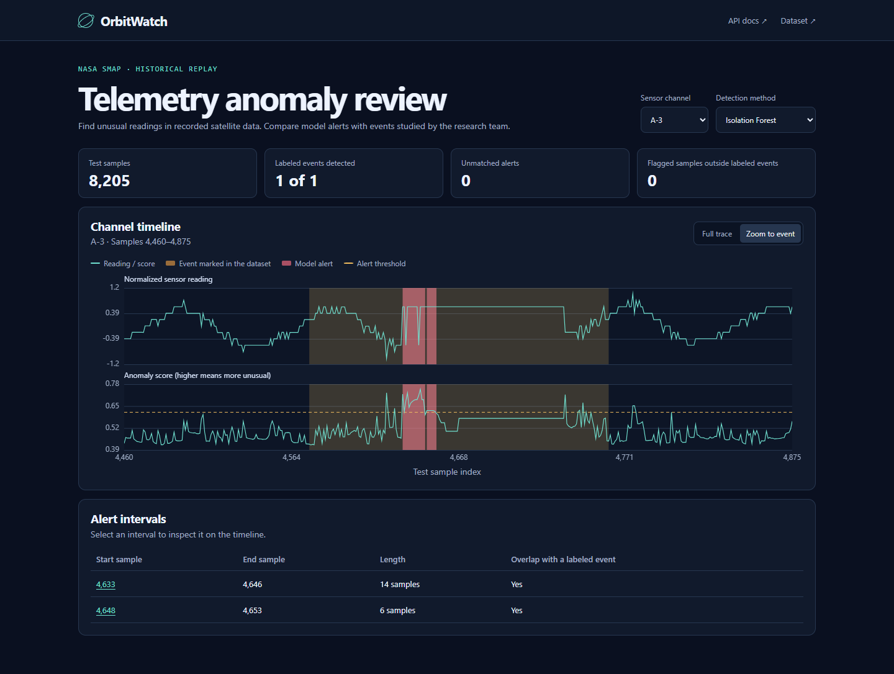

# OrbitWatch

OrbitWatch flags unusual readings in historical NASA SMAP satellite telemetry. A reviewer can switch between nine archived sensor channels, compare detection methods, and zoom to alert intervals. The FastAPI scoring endpoint also accepts new sequences in the same normalized units as the selected channel.



## Run locally

From this folder, run the following with Python 3.14 and PowerShell.

```powershell
python -m venv .venv
.\.venv\Scripts\python.exe -m pip install -r requirements.txt
.\.venv\Scripts\python.exe -m unittest discover -s tests -v
.\.venv\Scripts\python.exe -m orbitwatch.train
.\.venv\Scripts\python.exe -m uvicorn orbitwatch.api:app --port 8000
```

Open [the dashboard](http://127.0.0.1:8000/) and select **Zoom to event** on A-3. Gold marks the event in the dataset. Pink marks an interval flagged by the model. [API documentation](http://127.0.0.1:8000/docs) includes the request schema for scoring a sequence.

Training downloads pinned telemetry and labels into `data/`. Fitted models, timelines, and `metrics.json` are generated in `artifacts/`. GitHub Actions runs the unit tests, trains the models, builds the Docker image, and checks the running container.

## Docker and MLflow

After training, build and run the image.

```powershell
docker build -t orbitwatch .
docker run --rm -p 127.0.0.1:8000:8000 orbitwatch
```

To track an experiment locally, install the MLflow dependencies and run training with a tracking URI. The run records calibration settings, detector metrics, and model artifacts. An HTTP tracking server URI can also be supplied.

```powershell
.\.venv\Scripts\python.exe -m pip install -r requirements-tracking.txt
.\.venv\Scripts\python.exe -m orbitwatch.train --tracking-uri sqlite:///artifacts/tracking.db
```

## Benchmark result

Each detector fits on the first 75% of the benchmark's training split. The last 25% sets a channel-specific threshold at the 99th percentile of calibration scores. An alert interval contains at least three consecutive threshold exceedances. The combined method uses the maximum of the two threshold-normalized scores. A labeled event is counted as detected when an alert overlaps its interval.

| Detector | Labeled events detected | Unmatched alert intervals | Flagged samples outside labeled events |
| --- | ---: | ---: | ---: |
| Distance from median | 5 / 9 | 13 | 19,586 |
| Isolation Forest | 5 / 9 | 96 | 539 |
| Combined | 7 / 9 | 15 | 19,593 |

The evaluation covers 67,209 scored test samples. Isolation Forest is the dashboard default because it flagged the fewest samples outside labeled events in this backtest. Some long alerts overlap a labeled event and extend far beyond it, so both unmatched intervals and outside-label samples are reported. The combined rule was explored after the first three channels were inspected. Evaluate on new channels before generalizing these results to live telemetry.

## Data provenance

Kyle Hundman et al., *Detecting Spacecraft Anomalies Using LSTMs and Nonparametric Dynamic Thresholding* (2018). [NASA Technical Reports Server](https://ntrs.nasa.gov/citations/20210008188) · [Original Telemanom benchmark and labels](https://github.com/khundman/telemanom) · [Parquet mirror](https://huggingface.co/datasets/appleparan/telemanom)
